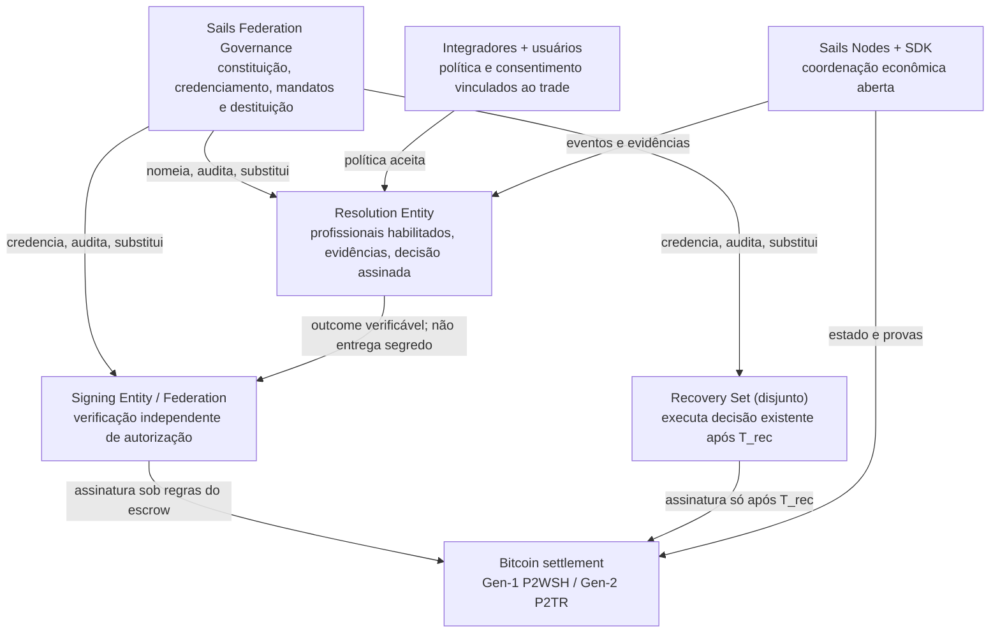
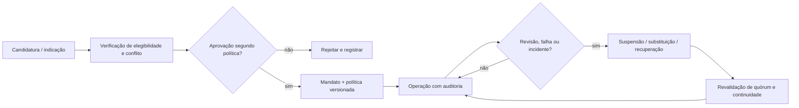
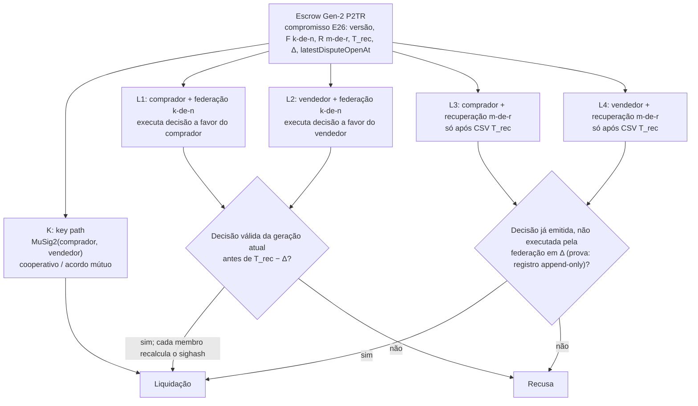

# CTO 28 — Sails Signing Federation: governança e diagramas (proposta Day 0)

> **Status:** registro de direção do proprietário e **proposta para revisão Principal/GK**; **não** é homologação de arquitetura criptográfica, GO de merge ou ativação econômica. 2026-11-21.
>
> **Legenda única:** *Implementado* = existe em código e prova (hoje: Gen-1 P2WSH 2-de-3, único rail Bitcoin real). *Proposto* = desenho da Entrega A (recomendação conjunta Principal + GK, **pendente de decisão do CTO**; texto integral em [`ENTREGA_A_GEN2_TAPROOT_SIGNING_FEDERATION.md`](ENTREGA_A_GEN2_TAPROOT_SIGNING_FEDERATION.md), resumo em [#619](https://github.com/sails-protocol/Sails-Protocol/issues/619#issuecomment-7070868210)). *Aprovado* = **nada**. Nenhuma frase deste documento deve ser lida acima do seu rótulo.
>
> **Rastreabilidade:** [#619](https://github.com/sails-protocol/Sails-Protocol/issues/619) (DDR, proposta), [#121](https://github.com/sails-protocol/Sails-Protocol/issues/121) (Taproot), [#438](https://github.com/sails-protocol/Sails-Protocol/issues/438), [#237](https://github.com/sails-protocol/Sails-Protocol/issues/237) (indisponibilidade do árbitro), [#293](https://github.com/sails-protocol/Sails-Protocol/issues/293) (timers), RFC-021 (Proposed; D2/D3 fora do caminho Day 0, CTO 25, [#619](https://github.com/sails-protocol/Sails-Protocol/issues/619#issuecomment-6831637336)), RFC-024 (Proposed; **mantida candidata**: a diretriz do CTO mudou a *prioridade*, não o status; a árvore da RFC-024 não é afirmada equivalente à da Entrega A). #121: análise regulatória por jurisdição é **lacuna aberta**. #438: pesquisa, **sem bond/slashing no Day 0**. E26 (#105): homologação documental em HOLD; o compromisso Gen-2 (versão, F, R, T_rec, Δ, `latestDisputeOpenAt`) é proposta da Entrega A.

## 1. Direção de produto e fronteiras

O protocolo/SDK de coordenação econômica continua aberto à integração. **O poder de resolver disputas e o poder de assinar liquidações não são permissionless por padrão.** A governança Sails deverá poder constituir entidades federadas e selecionar, credenciar, eleger/nomear, supervisionar, suspender e substituir profissionais com mandato e política verificáveis.

Uma entidade de **resolução** (= a Resolution Layer da #619; decisões registradas como rulings Sails) decide com base em evidências, consentimento e regras vinculadas ao escrow; uma entidade de **assinatura** verifica autorização e só então exerce sua capacidade criptográfica. Governança, resolução e assinatura devem ter funções, chaves, permissões e trilhas de auditoria distintas. O modelo não torna a Sails imune a obrigações regulatórias.

### Diagrama A — Separação institucional (arquitetura-alvo)

**Invariante:** o resultado arbitral não equivale a autorização irrestrita para mover fundos; a assinatura válida deve estar restrita ao destino, montantes, geração, outpoint, fee e política comprometidos. Cada membro recalcula o sighash BIP341 a partir de dados comprometidos; só `SIGHASH_DEFAULT`/`ALL` (ANYONECANPAY, NONE e SINGLE recusados). A autorização lógica atual é insuficiente se o nó também controla o segredo da assinatura: a verificação Ed25519 roda no mesmo processo que detém o seed e **não protege os fundos contra o comprometimento do nó ou do seed**. Vários operadores com o **mesmo** seed são a mesma autoridade, não federação; `TRUSTED_ARBITRATORS` não é independência. A **governança não tem chave, não assina e não decide**; nenhum membro do conselho ou resolvedor ocupa assento na federação ou na recuperação; ato de governança só afeta escrows novos. A **recuperação executa uma decisão já emitida e nunca decide**.

## 2. Modelo de governança a especificar e homologar

| Domínio | Requisito de decisão Day 0 |
| --- | --- |
| Entidade | Identidade, escopo de atuação, responsável, isolamento por integrador e registro verificável |
| Seleção | Critérios objetivos de qualificação, credenciamento e eleição/nomeação; quem pode votar/aprovar |
| Mandato | Duração, renovação, suspensão, revogação, substituição e recurso |
| Integridade | Impedimento por conflito de interesses, segregação de funções, auditoria e registro imutável |
| Resolução | Evidências, cadeia de custódia, quorum decisório, contestação, fallback e SLAs |
| Assinatura | Quórum criptográfico independente, operadores e hosts separados, limites de autorização |
| Segurança | Backup **da chave de cada membro** (sem segredo comum), restauração testada por membro, perda de quórum, compromisso de chave, contenção e rotação |
| Consentimento | Identidade da entidade, versão/hash da política e autoridade efetiva conhecidos antes do escrow; sem troca unilateral após compromisso |
| Continuidade | Tratamento de operador indisponível, revogado, comprometido e de parte não cooperativa |
| Poderes | Governança não pode reescrever retroativamente as condições de gasto de um escrow |

**Quórum arbitral e quórum de assinatura são diferentes.** Um exemplo 3-de-5 (federação) e 2-de-3 (recuperação, conjunto **disjunto**) é apenas hipótese de avaliação, não parâmetro aprovado. **k membros + a parte perdedora = roubo daquele escrow.** Conluio é tratado como ameaça técnica mesmo com profissionais de confiança; confiança operacional não substitui controles criptográficos.

### Diagrama B — Constituição e ciclo de vida da entidade

**Proposto (Entrega A), sem reshare na Gen-2 Day 0:** toda troca de membro = nova versão do conjunto, com **novas pubkeys só para escrows novos**; escrows existentes mantêm as chaves comprometidas até ficarem terminais. Reshare/FROST é resíduo declarado (G9) e não é usado. A troca da chave pública nunca transfere controle de UTXOs antigos.

## 3. Assinatura e recuperação — Gen-1 versus Gen-2

**Estado atual:** Gen-1 P2WSH 2-de-3 por escrow; o nó detém o `MULTISIG_SEED` que deriva a terceira chave. O árbitro é derivado do seed (`multisig.provider.ts:462-512`, `688-698`) e a decisão Ed25519 (`arbitration-authority.ts:107-125`) roda no mesmo processo: **não protege contra o operador**. Separação de decisão existe em lógica, **não** há separação operacional/criptográfica do signatário. A federação ainda **não está implementada**.

**P1 (Tier 3):** fronteira `SettlementSigner` sem alteração econômica, compatível com Gen-1. **P2 (Tier 3):** signatário externo que nunca compartilha segredo com o nó, reconstrói independentemente a transação e recusa destino/valor/outpoint adulterados. **Federação distribuída:** desenho **proposto** na Entrega A (recomendação conjunta Principal + GK, **pendente de decisão do CTO**; não homologada, não implementada); exige testes, recuperação e independência; signatário externo único não é federação.

**Gen-2 Day 0 — nova prioridade do proprietário:** arquitetura P2TR com caminhos de gasto e recuperação especificados, testados e homologados **antes da ativação econômica pública**. RFC-024 permanece candidata até revisão e decisão expressa CTO; nenhum código econômico irreversível autorizado por este registro. **Proposto:** MuSig2 **só** no key path comprador+vendedor; folhas de disputa e de recuperação com k-de-n nativo (`OP_CHECKSIGADD`), chaves independentes, sem DKG; FROST adiado (otimização futura, exige auditoria). Gen-1 (ECDSA) e Gen-2 (Schnorr) exigem análise separada; não presumir que o mesmo esquema serve aos dois.

### Diagrama C — Árvore candidata da Entrega A (recomendação conjunta, PENDENTE do CTO, NÃO homologada)

**Nenhuma folha de uma parte só nem só da federação; o nó não detém chave; k, n, m, r, T_rec e Δ são referências pendentes de decisão do CTO.** Resíduos declarados da Entrega A (5, §13.5) permanecem abertos, inclusive reshare/FROST futuro e perda da chave do vencedor.

**Proibição de inferência:** um timelock unilateral para o vendedor pode violar a proteção do comprador após pagamento fiat; não é mecanismo aprovado. Um novo quorum ou nova chave não consegue gastar escrows cujos scripts antigos não o autorizam. Escrows Gen-1 existentes não migram automaticamente.

## 4. Falhas e respostas obrigatórias

| Evento | Propriedade a demonstrar |
| --- | --- |
| Um operador desaparece | Quórum permanece disponível ou recuperação segura comprovada |
| Chave de membro perdida | Tolerada até n−k; backup por membro; nova versão do conjunto só para escrows novos |
| Quórum perdido | Depois de T_rec, o conjunto de recuperação **executa a decisão já emitida** (nunca decide), com prova do registro append-only e não do banco do nó; sem decisão, é resíduo declarado |
| Operador comprometido | Revogação operacional, contenção, análise dos escrows existentes e rotação segura |
| Nó malicioso | Signatário rejeita PSBT/destino/fee/outpoint manipulados, recalculando de fontes independentes |
| Parte paga fiat e contraparte não coopera | Sem timeout que permita saque indevido; corte T_rec−Δ; abertura automática da disputa em `latestDisputeOpenAt` (linha do CTO pendente); definir prova e recurso |
| Vencedor perde a chave | Resíduo declarado; backup obrigatório e aviso na UI |
| Decisão arbitral adulterada | Verificação de assinatura, política, consentimento, quórum, prazo e vínculo ao trade |
| Federação em conluio com uma parte | Modelagem adversarial e controles técnicos; registrar risco residual |
| Mudança de membros ou política | Nunca alterar retroativamente autoridade de escrow existente |

## 5. Execução, revisão e gates

1. **EPM:** relacionar este registro a #619, #121, #438 e Project #3 sem backlog paralelo; manter M-1b P0 e correções Arkade em andamento.
2. **Principal:** propor parâmetros e protocolo(s) exatos, matriz de autoridade por spending path, modelo de chaves, compatibilidade Gen-1/Gen-2, fee-reserve/Payjoin e migração apenas para **novos** escrows versionados.
3. **GK:** revisar ameaças, independência, conluio, no-show, recovery, restauração e testes adversariais; especificar evidência e gates por SHA.
4. **Principal + GK (função de auditoria documental):** localizar decisões históricas e distinguir registro de intenção, proposta, homologação e implementação.
5. **CTO:** homologar separadamente governança, parâmetros de quórum, caminhos de gasto, política de recuperação, rollout e merges Tier 3/4.

**Estado:** registro documental e diagramas explicativos **em revisão**. **NO-GO** para ativação pública, migração e implementação econômica sem aprovação específica.
