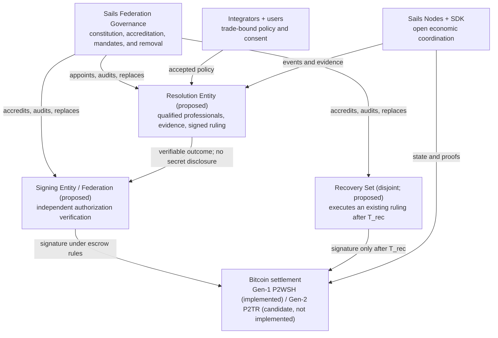
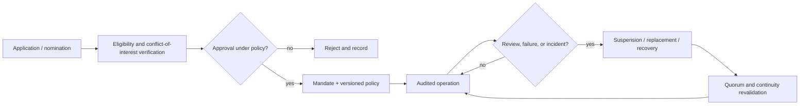
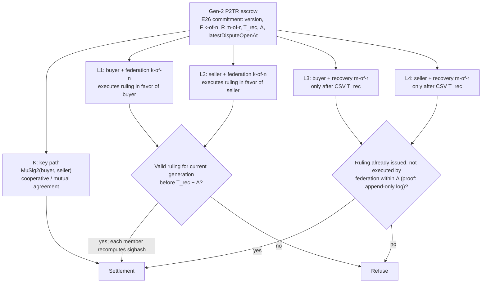

# CTO 28 — Sails Signing Federation: Governance and Diagrams (Day 0 Proposal)

> **Status:** Record of the project owner's direction and a **proposal for Principal/GK review**; **not** cryptographic architecture homologation, merge authorization, or economic activation. 2026-11-21. **Delivery A: conditionally approved as a direction/proposal (CTO 28); Delivery B NOT authorized; Gen-2 activation NO-GO.** Three distinct classifications: (1) *approved decision* = only the direction of Delivery A, conditional, with parameters pending; (2) *proven implementation* = Gen-1 only; (3) *operational homologation* = none.
>
> **Single status legend:** *Implemented* = exists in code with evidence (currently: Gen-1 P2WSH 2-of-3, the only real Bitcoin rail). *Proposed* = Delivery A design (joint Principal + GK recommendation, **conditionally approved (CTO 28) as a direction; parameters pending**; full text in [`ENTREGA_A_GEN2_TAPROOT_SIGNING_FEDERATION.md`](ENTREGA_A_GEN2_TAPROOT_SIGNING_FEDERATION.md), summary in [#619](https://github.com/sails-protocol/Sails-Protocol/issues/619#issuecomment-7070868210)). *Approved* = only the **direction** of Delivery A (CTO 28 conditional approval); **nothing** beyond Gen-1 is implemented or homologated, and no parameters have been decided. No statement in this document may be interpreted beyond its status label.
>
> **Traceability:** [#619](https://github.com/sails-protocol/Sails-Protocol/issues/619) (DDR, proposal), [#121](https://github.com/sails-protocol/Sails-Protocol/issues/121) (Taproot), [#438](https://github.com/sails-protocol/Sails-Protocol/issues/438), [#237](https://github.com/sails-protocol/Sails-Protocol/issues/237) (arbiter unavailability), [#293](https://github.com/sails-protocol/Sails-Protocol/issues/293) (timers), RFC-021 (Proposed; D2/D3 outside the Day 0 path, CTO 25, [#619](https://github.com/sails-protocol/Sails-Protocol/issues/619#issuecomment-6831637336)), RFC-024 (Proposed; **remains a candidate**: the CTO direction changed its *priority*, not its status; the RFC-024 tree is not claimed to be equivalent to the Delivery A tree). #121: jurisdiction-specific regulatory analysis remains **an open gap**. #438: research, **no bond/slashing on Day 0**. E26 (#105): documentary homologation on HOLD; the Gen-2 commitment (version, F, R, T_rec, Δ, `latestDisputeOpenAt`) is a Delivery A proposal.

## 1. Product Direction and Boundaries

The economic coordination protocol/SDK remains open to integration. **The authority to resolve disputes and the authority to sign settlements are not permissionless by default.** Sails governance must be able to constitute federated entities and select, accredit, elect/appoint, supervise, suspend, and replace professionals under verifiable mandates and policies.

A **resolution** entity (= the Resolution Layer in #619; decisions recorded as Sails rulings) decides based on evidence, consent, and escrow-bound rules; a **signing** entity verifies authorization before exercising its cryptographic signing capability. Governance, resolution, and signing must have distinct roles, keys, permissions, and audit trails. This model does not exempt Sails from regulatory obligations.

### Diagram A — Institutional Separation (Target Architecture)

**Invariant:** An arbitration outcome is not unrestricted authorization to move funds; a valid signature must be constrained to the committed destination, amounts, generation, outpoint, fee, and policy. Each member recomputes the BIP341 sighash from committed data; only `SIGHASH_DEFAULT`/`ALL` are accepted (ANYONECANPAY, NONE, and SINGLE are rejected). Current logical authorization is insufficient if the node also controls the signing secret: Ed25519 verification runs in the same process that holds the seed and **does not protect funds against compromise of the node or seed**. Multiple operators using the **same** seed constitute one authority, not a federation; `TRUSTED_ARBITRATORS` does not establish independence. **Governance holds no key, does not sign, and does not rule**; no council member or resolver occupies a federation or recovery seat; governance actions affect only new escrows. **Recovery executes an already issued ruling and never decides.**

## 2. Governance Model to Specify and Homologate

| Domain | Day 0 Decision Requirement |
| --- | --- |
| Entity | Identity, scope of authority, accountable party, per-integrator isolation, and verifiable registry |
| Selection | Objective qualification, accreditation, and election/appointment criteria; who may vote/approve |
| Mandate | Term, renewal, suspension, revocation, replacement, and appeal |
| Integrity | Conflict-of-interest exclusions, separation of duties, audit, and immutable record |
| Resolution | Evidence, chain of custody, decision quorum, challenge, fallback, and SLAs |
| Signing | Independent cryptographic quorum, separate operators and hosts, authorization limits |
| Security | Backup **of each member's key** (no shared secret), member-tested restoration, quorum loss, key compromise, containment, and rotation |
| Consent | Entity identity, policy version/hash, and effective authority known before escrow; no unilateral replacement after commitment |
| Continuity | Handling unavailable, revoked, or compromised operators and non-cooperative parties |
| Powers | Governance cannot retroactively rewrite the spending conditions of an existing escrow |

**The arbitration quorum and signing quorum are different.** An example of 3-of-5 (federation) and 2-of-3 (recovery, a **disjoint** set) is an evaluation hypothesis only, not an approved parameter. **k members + the losing party can steal that escrow.** Collusion is treated as a technical threat even with trusted professionals; operational trust is no substitute for cryptographic controls.

### Diagram B — Entity Constitution and Lifecycle

**Proposed (Delivery A), without resharing in Gen-2 Day 0:** each membership change creates a new set version, with **new public keys for new escrows only**; existing escrows retain their committed keys until terminal. Resharing/FROST is a declared residual (G9) and is not used. Changing a public key never transfers control of old UTXOs.

## 3. Signing and Recovery — Gen-1 versus Gen-2

**Current state:** Gen-1 P2WSH 2-of-3 per escrow; the node holds `MULTISIG_SEED`, which derives the third key. The arbiter key derives from that seed (`multisig.provider.ts:462-512`, `688-698`), and Ed25519 ruling verification (`arbitration-authority.ts:107-125`) runs in the same process: **it does not protect against the operator**. Decision separation is **partial** in application logic — Gen-1 dispute-path signing guards are **under correction** — and the signer has **no operational or cryptographic separation**. The federation is **not implemented**.

**P1 (Tier 3):** `SettlementSigner` boundary without economic changes, compatible with Gen-1. **P2 (Tier 3):** external signer that never shares its secret with the node, independently reconstructs the transaction, and refuses tampered destinations, amounts, or outpoints. **Distributed federation:** design **proposed** in Delivery A (joint Principal + GK recommendation, **conditionally approved (CTO 28) as a direction; parameters pending**; not homologated or implemented); requires tests, recovery, and independence; a single external signer is not a federation.

**Gen-2 Day 0 — new owner priority:** specify, test, and homologate P2TR architecture with spending and recovery paths **before public economic activation**. RFC-024 remains a candidate pending review and an express CTO decision; this record authorizes no irreversible economic code. Gen-2 activation: **NO-GO** until homologation; not implemented. **Proposed:** MuSig2 **only** in the buyer+seller key path; dispute and recovery leaves use native k-of-n (`OP_CHECKSIGADD`), independent keys, no DKG; FROST deferred (future optimization requiring audit). Gen-1 (ECDSA) and Gen-2 (Schnorr) require separate analysis; do not assume one scheme works for both.

### Diagram C — Candidate Delivery A Tree (joint recommendation, conditionally approved by CTO 28 as a direction; parameters pending; NOT homologated, NOT implemented)

**No single-party or federation-only leaves; the node holds no key; k, n, m, r, T_rec, and Δ are reference values; parameters pending (CTO 28 conditional approval).** The five declared Delivery A residuals (§13.5) remain open, including future resharing/FROST and loss of the winner's key.

**Prohibited inference:** A unilateral seller timelock may violate buyer protection after fiat payment; it is not an approved mechanism. A new quorum or key cannot spend escrows whose old scripts do not authorize it. Existing Gen-1 escrows do not migrate automatically.

## 4. Failures and Required Responses

| Event | Property to Demonstrate |
| --- | --- |
| An operator disappears | Quorum remains available or safe recovery is demonstrated |
| Member key lost | Tolerated up to n−k; per-member backup; new set version for new escrows only |
| Quorum lost | After T_rec, the recovery set **executes the ruling already issued** (never decides), with proof from the append-only log rather than the node database; no ruling is a declared residual |
| Compromised operator | Operational revocation, containment, analysis of existing escrows, and safe rotation |
| Malicious node | Signer rejects manipulated PSBT/destination/fee/outpoint by independently recomputing from independent sources |
| Party pays fiat and counterparty does not cooperate | No timeout enabling improper withdrawal; T_rec−Δ cutoff; automatic dispute opening at `latestDisputeOpenAt` (CTO decision pending); define proof and appeal |
| Winner loses their key | Declared residual; mandatory backup and UI warning |
| Tampered arbitration ruling | Verify signature, policy, consent, quorum, deadline, and trade binding |
| Federation colludes with a party | Adversarial modeling and technical controls; record residual risk |
| Member or policy changes | Never retroactively change authority over existing escrows |

## 5. Execution, Review, and Gates

1. **EPM:** link this record to #619, #121, #438, and Project #3 without a parallel backlog; keep M-1b P0 and Arkade corrections in progress.
2. **Principal:** propose exact parameters and protocol(s), spending-path authority matrix, key model, Gen-1/Gen-2 compatibility, fee-reserve/Payjoin, and migration for **new** versioned escrows only.
3. **GK:** review threats, independence, collusion, no-shows, recovery, restoration, and adversarial tests; specify evidence and SHA-based gates.
4. **Principal + GK (documentary-audit function):** locate historical decisions and distinguish intent records, proposals, homologation, and implementation.
5. **CTO:** separately homologate governance, quorum parameters, spending paths, recovery policy, rollout, and Tier 3/4 merges.

**Status:** Documentary record and explanatory diagrams **under review**. **NO-GO** for public activation, migration, or economic implementation without specific approval. Delivery A: conditionally approved as a direction/proposal (CTO 28); Delivery B NOT authorized; Gen-2 activation NO-GO.
