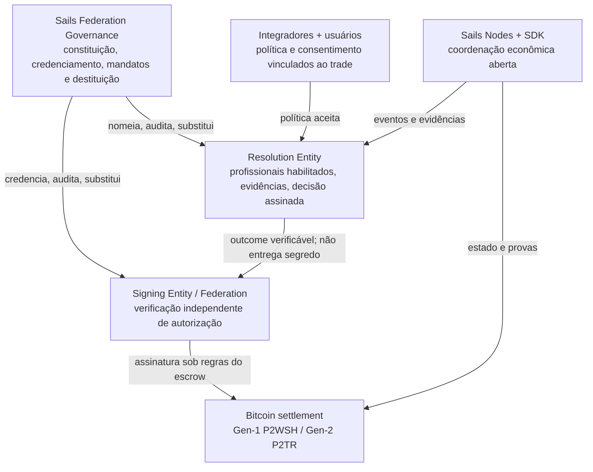
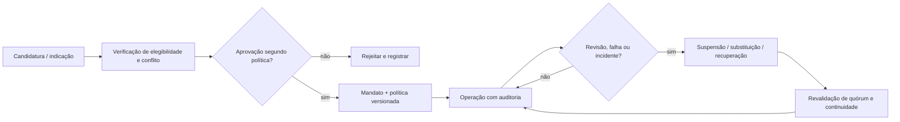
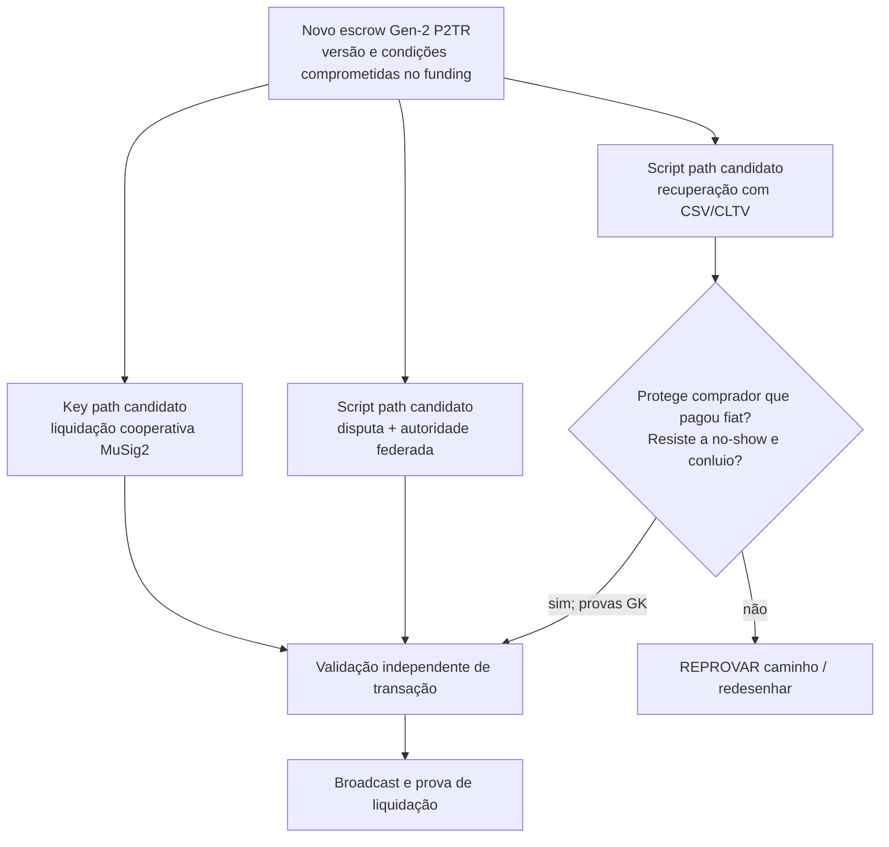

# CTO 28 — Sails Signing Federation: governança e diagramas (proposta Day 0)

> **Status:** registro de direção do proprietário e **proposta para revisão Principal/GK**; **não** é homologação de arquitetura criptográfica, GO de merge ou ativação econômica. 2026-11-21.
>
> **Rastreabilidade:** [#619](https://github.com/sails-protocol/Sails-Protocol/issues/619) (DDR, proposta), [#121](https://github.com/sails-protocol/Sails-Protocol/issues/121) (Taproot), [#438](https://github.com/sails-protocol/Sails-Protocol/issues/438), [#237](https://github.com/sails-protocol/Sails-Protocol/issues/237) (indisponibilidade do árbitro), [#293](https://github.com/sails-protocol/Sails-Protocol/issues/293) (timers), RFC-021 (Proposed), RFC-024 (architecture candidate only). E26 permanece HOLD.

## 1. Direção de produto e fronteiras

O protocolo/SDK de coordenação econômica continua aberto à integração. **O poder de resolver disputas e o poder de assinar liquidações não são permissionless por padrão.** A governança Sails deverá poder constituir entidades federadas e selecionar, credenciar, eleger/nomear, supervisionar, suspender e substituir profissionais com mandato e política verificáveis.

Uma entidade de **resolução** decide com base em evidências, consentimento e regras vinculadas ao escrow; uma entidade de **assinatura** verifica autorização e só então exerce sua capacidade criptográfica. Governança, resolução e assinatura devem ter funções, chaves, permissões e trilhas de auditoria distintas. O modelo não torna a Sails imune a obrigações regulatórias.

### Diagrama A — Separação institucional (arquitetura-alvo)

**Invariante:** o resultado arbitral não equivale a autorização irrestrita para mover fundos; a assinatura válida deve estar restrita ao destino, montantes, geração, outpoint, fee e política comprometidos. A autorização lógica atual é insuficiente se o nó também controla o segredo da assinatura.

## 2. Modelo de governança a especificar e homologar

| Domínio | Requisito de decisão Day 0 |
| --- | --- |
| Entidade | Identidade, escopo de atuação, responsável, isolamento por integrador e registro verificável |
| Seleção | Critérios objetivos de qualificação, credenciamento e eleição/nomeação; quem pode votar/aprovar |
| Mandato | Duração, renovação, suspensão, revogação, substituição e recurso |
| Integridade | Impedimento por conflito de interesses, segregação de funções, auditoria e registro imutável |
| Resolução | Evidências, cadeia de custódia, quorum decisório, contestação, fallback e SLAs |
| Assinatura | Quórum criptográfico independente, operadores e hosts separados, limites de autorização |
| Segurança | Backup **das participações**, restauração testada, perda de quórum, compromisso de chave, contenção e rotação |
| Consentimento | Identidade da entidade, versão/hash da política e autoridade efetiva conhecidos antes do escrow; sem troca unilateral após compromisso |
| Continuidade | Tratamento de operador indisponível, revogado, comprometido e de parte não cooperativa |
| Poderes | Governança não pode reescrever retroativamente as condições de gasto de um escrow |

**Quórum arbitral e quórum de assinatura são diferentes.** Um exemplo 3-de-5 é apenas hipótese de avaliação, não parâmetro aprovado. Conluio é tratado como ameaça técnica mesmo com profissionais de confiança; confiança operacional não substitui controles criptográficos.

### Diagrama B — Constituição e ciclo de vida da entidade

A substituição de membro pode, **dependendo do protocolo de assinatura**, preservar a chave pública via renovação de participações; a troca da chave pública **não** transfere controle de UTXOs antigos para a nova chave.

## 3. Assinatura e recuperação — Gen-1 versus Gen-2

**Estado atual:** Gen-1 P2WSH 2-de-3 por escrow; o nó detém o `MULTISIG_SEED` que deriva a terceira chave. Separação de decisão Ed25519 existe em lógica, **não** há separação operacional/criptográfica do signatário. A federação ainda **não está implementada**.

**P1 (Tier 3):** fronteira `SettlementSigner` sem alteração econômica, compatível com Gen-1. **P2 (Tier 3):** signatário externo que nunca compartilha segredo com o nó, reconstrói independentemente a transação e recusa destino/valor/outpoint adulterados. **Federação distribuída** requer desenho adicional, testes de limiar, recuperação e independência; signatário externo único não é federação.

**Gen-2 Day 0 — nova prioridade do proprietário:** arquitetura P2TR com caminhos de gasto e recuperação especificados, testados e homologados **antes da ativação econômica pública**. RFC-024 permanece candidata até revisão e decisão expressa CTO; nenhum código econômico irreversível autorizado por este registro. MuSig2 não oferece recuperação sozinho; FROST e outros protocolos de limiar precisam de análise de compatibilidade com Schnorr/Taproot e, separadamente, com a assinatura ECDSA necessária à Gen-1 P2WSH. Não presumir que o mesmo esquema serve aos dois.

### Diagrama C — Caminhos de gasto candidatos (NÃO homologados)

**Proibição de inferência:** um timelock unilateral para o vendedor pode violar a proteção do comprador após pagamento fiat; não é mecanismo aprovado. Um novo quorum ou nova chave não consegue gastar escrows cujos scripts antigos não o autorizam. Escrows Gen-1 existentes não migram automaticamente.

## 4. Falhas e respostas obrigatórias

| Evento | Propriedade a demonstrar |
| --- | --- |
| Um operador desaparece | Quórum permanece disponível ou recuperação segura comprovada |
| Participações perdidas | Restauração de participações com controles independentes, sem revelar segredo completo |
| Quórum perdido | Caminho de gasto alternativo precomprometido ou limitação explícita; não prometer recuperação impossível |
| Operador comprometido | Revogação operacional, contenção, análise dos escrows existentes e rotação segura |
| Nó malicioso | Signatário rejeita PSBT/destino/fee/outpoint manipulados, recalculando de fontes independentes |
| Parte paga fiat e contraparte não coopera | Sem timeout que permita saque indevido; definir prova e recurso |
| Decisão arbitral adulterada | Verificação de assinatura, política, consentimento, quórum, prazo e vínculo ao trade |
| Federação em conluio com uma parte | Modelagem adversarial e controles técnicos; registrar risco residual |
| Mudança de membros ou política | Nunca alterar retroativamente autoridade de escrow existente |

## 5. Execução, revisão e gates

1. **EPM:** relacionar este registro a #619, #121, #438 e Project #3 sem backlog paralelo; manter M-1b P0 e correções Arkade em andamento.
2. **Principal:** propor parâmetros e protocolo(s) exatos, matriz de autoridade por spending path, modelo de chaves, compatibilidade Gen-1/Gen-2, fee-reserve/Payjoin e migração apenas para **novos** escrows versionados.
3. **GK:** revisar ameaças, independência, conluio, no-show, recovery, restauração e testes adversariais; especificar evidência e gates por SHA.
4. **Auditor Documental:** localizar decisões históricas e distinguir registro de intenção, proposta, homologação e implementação.
5. **CTO:** homologar separadamente governança, parâmetros de quórum, caminhos de gasto, política de recuperação, rollout e merges Tier 3/4.

**Estado:** registro documental e diagramas explicativos **em revisão**. **NO-GO** para ativação pública, migração e implementação econômica sem aprovação específica.
