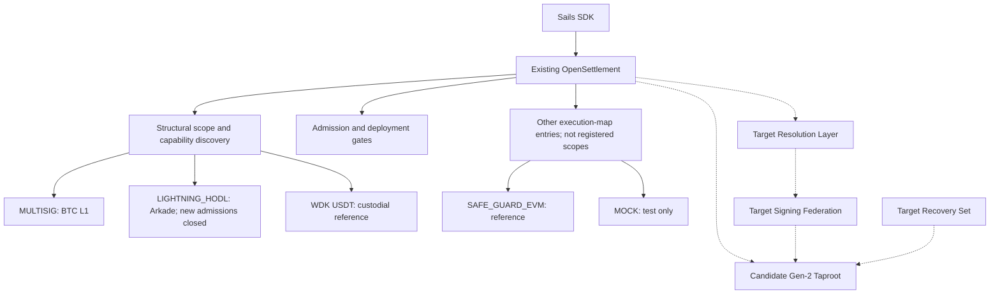
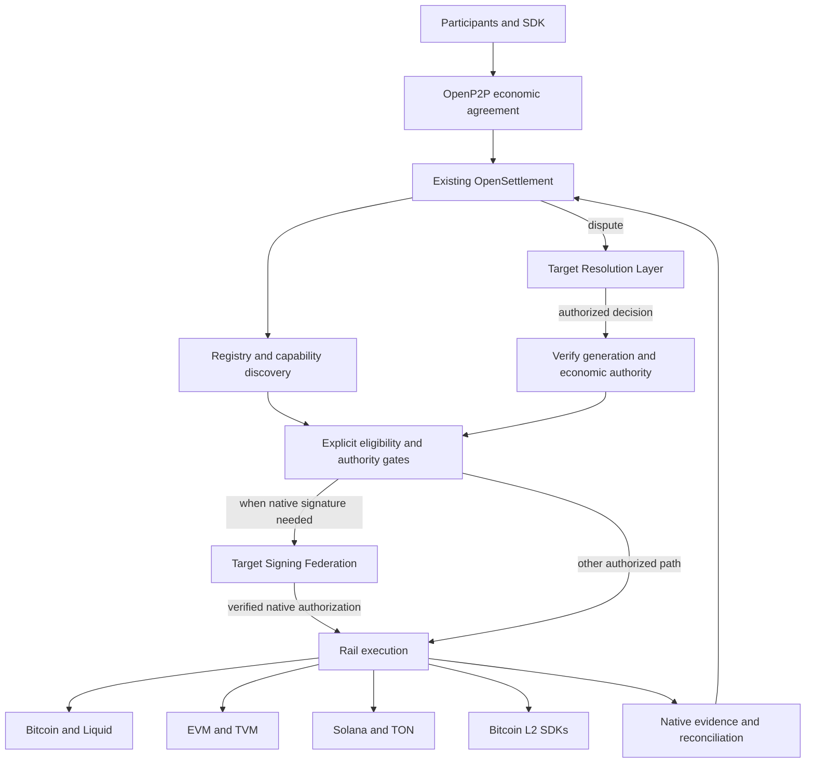
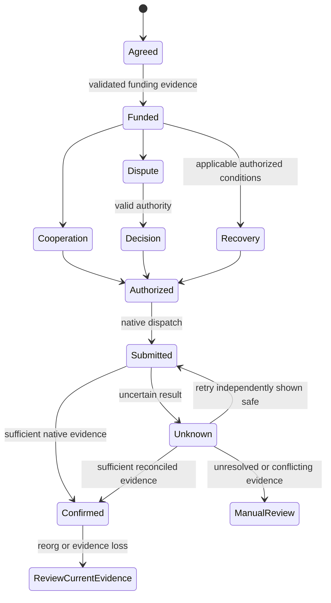
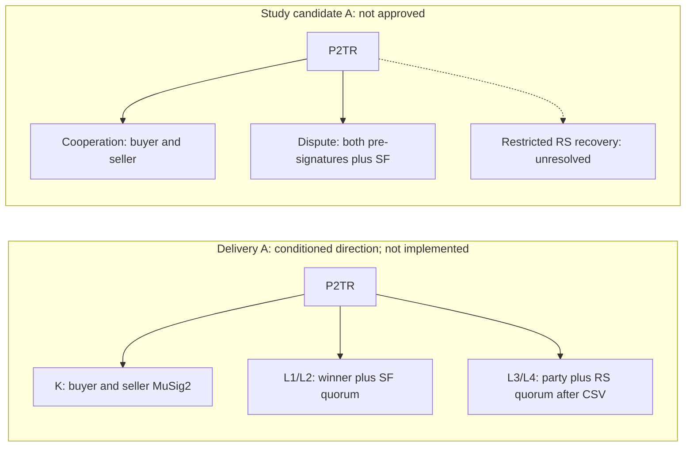
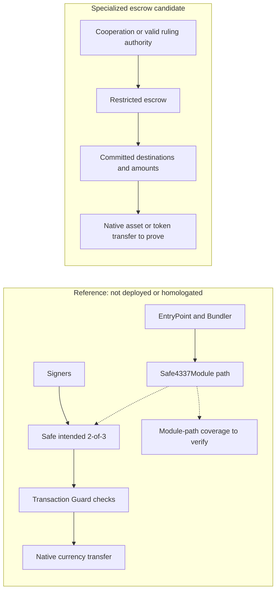
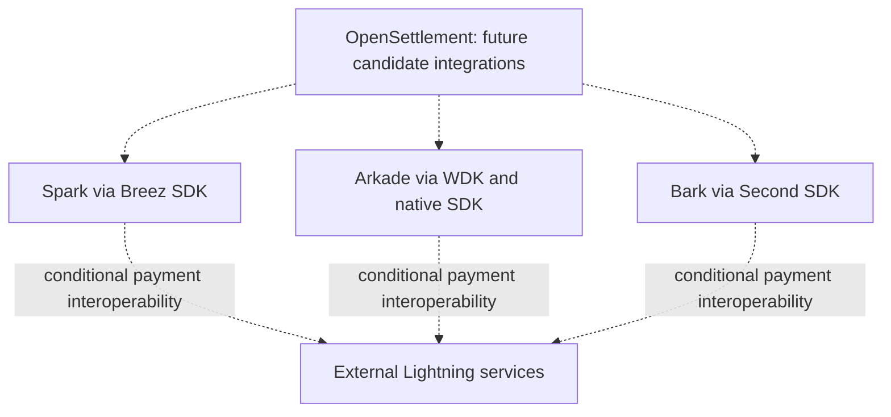
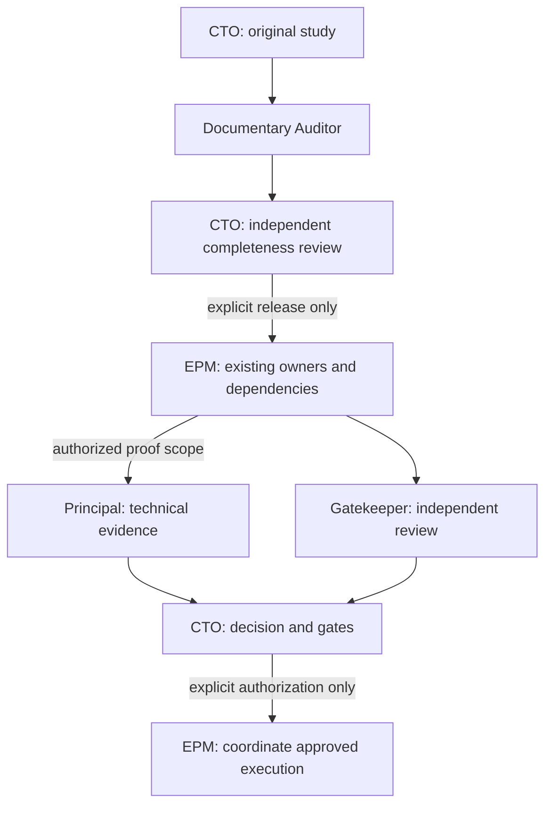

> **Non-normative companion study.** Candidate constructions only. RFC-024 remains a candidate. This document makes no architecture, production or activation decision. Published on 2026-11-28 as a complementary document, under CTO authorization (decision D-01).

# Sails Protocol — Universal Settlement Architecture & Escrow Simplification

**Study 01 (A–G) | Documentary review candidate for the CTO**  
**Source:** 27 November 2026; original preserved separately.  
**Status:** CANDIDATE / NOT HOMOLOGATED / NO ECONOMIC ACTIVATION.  
**Code baseline:** [`8aab207ecb1d074c43e7dabccd7c107c568afe45`](https://github.com/sails-protocol/Sails-Protocol/commit/8aab207ecb1d074c43e7dabccd7c107c568afe45). All repository claims below refer to that snapshot unless a dated institutional decision is explicitly identified. This is a research companion, not an ADR, RFC, normative specification or authorized implementation plan. The CTO reviews this revision before any EPM handoff.

> *Status note: historical process record of the review at the time; superseded by the publication header above.*

## 1. Executive summary

Research prompted by OpenBazaar's resurgence identified an opportunity to constrain the financial authority of resolution executors without importing unnecessary cryptographic complexity. Sails already has OpenSettlement, provider interfaces, structural capability discovery and distinct concepts of decision and execution authority. Federated resolution, signing and recovery are target arrangements, not deployed components. Evolve the existing settlement architecture rather than create a parallel escrow protocol.

Unify economic semantics and common conformance requirements, not necessarily cryptographic mechanisms. Each rail must demonstrate its native guarantees and expose only its actual capabilities. Removing an arbiter's financial key does not necessarily remove the arbiter's economic influence. Constrain admissible outcomes, including under collusion, without sacrificing recovery, flexibility or security.

Study A (bilateral pre-authorizations plus federated signing) first; compare hashlock and adaptor-signature alternatives as justified. Compare specialized EVM escrow with the existing Safe approach; reuse Bitcoin L2 SDKs where their capabilities are proven. These are investigation preferences, not decisions to replace implementations. No security equivalence, code reduction or operational savings have been demonstrated. Gen-2 is already a Day-0 exit requirement, but the study candidates are not themselves approved implementations.

## 2. Established premises and boundaries

- Open integration for the protocol and SDK does not imply permissionless dispute resolution or signing. Preserve accredited governance rather than create an unrestricted arbiter market.
- Target roles: Resolution Layer (RL) decides; Signing Federation (SF) independently verifies authorization and signs when necessary; Recovery Set (RS), disjoint from SF in Delivery A, has a limited recovery mandate. Distinct mandates, keys and quorums; no additional federated body is proposed. Governance does not itself decide or sign.
- Sails Nodes coordinate economic activity; this study preserves the CTO premise of no Sails-operated Lightning nodes, channels, routing liquidity, LND/CLN/Eclair or proprietary Lightning bridge. Third-party dependencies are not eliminated by this premise.
- Evaluate Spark via Breez SDK, Arkade via WDK and native SDK, and Bark via Second's native SDK. These are research integration paths, not confirmed Sails provider support. Lightning is a payment network, not a blockchain or proof of escrow.
- Bitcoin network fees are an operational variable. Preserve existing break-even and fee-policy requirements; evaluate fee bumping and practical exits without assuming L2 removes fee spikes.
- Preserve SPLIT wherever required by the existing capability or policy; disclose missing support and non-atomic two-leg transfers. No implicit reduction of split flexibility.
- Preserve simple UX, client-held participant financial keys, and separation of economic identity, social/transport identity and escrow secrets. Recovery of escrow material is necessary where applicable; identity backup must not become a new prerequisite for recovery of funds.
- No new module, parallel consensus, automatic migration of funded escrows, modification of critical queue, merge, deployment or activation authorization.
- Bastiat's visible/invisible cost principle: evaluate maintenance, dependencies, audit burden, recovery, wallet compatibility, extra rounds, infrastructure, migration and security. Fewer lines of code do not establish simplicity or safety.

**Institutional scope:** ADR-002 §5A records 14 native P2P Day-0 product combinations, not availability: BTC on Bitcoin L1 and Liquid; USDT on Ethereum, Polygon, Base, Arbitrum, TON, Tron and Solana; USDC on Ethereum, Polygon, Base, Arbitrum and Solana. Its older 25-row catalog is not the commitment. The 21 November decision on #147 excludes native Lightning, Spark/Lightning and Arkade from Day-0 economic activation; no UI creation/execution or escrow promise. Research on other rails does not expand this scope. Bark is research only. The no-own-Lightning-node premise is retained from the CTO study; the public #147 record confirms research prioritization over own-node/custodial approaches, not a universal proof about every possible integration.

## 3. Evidence at the fixed baseline

Selective source inspection only; no new tests or deployments. See §12 and the traceability matrix.

| Element | Observed evidence | Classification |
|---|---|---|
| SettlementProvider | `escrow-providers.ts:121–154`: lock, release, refund, optional split interface | Existing contract; not evidence of every provider's capabilities |
| Execution map / registry | `escrow-providers.ts:181–212`; `settlement-provider-registry.ts:124–184` | Five executable-map entries, three structural registrations; different from availability |
| Adaptive Execution | Mission 4 §§3.3–3.4, 13, 17 | Scope membership and structural capability only; no full permission, maturity, health or multi-candidate scoring evaluation by this slice |
| Bitcoin Gen-1 | P2WSH 2-of-3, participant client keys, server arbiter key; PSBT signature collection and SPLIT | Implemented; one historical cooperative micro-value mainnet release, not production authorization or independent audit |
| Bitcoin Gen-2 | RFC-024; Delivery A K/L1–L4; revision 3 and GK corrections | Day-0 exit requirement; Delivery A conditionally approved; no homologation or economic Delivery B authorization; not implemented |
| Arkade | `LIGHTNING_HODL`, @arkade-os/sdk, VTXOs/checkpoints, client participant keys and server arbiter | Testnet reference; new admissions closed in every environment, existing escrow rules preserved |
| WDK_USDT_EVM | USDT Ethereum, server seed, direct transfers, two-leg SPLIT | Server-custodial reference, production-ineligible under RFC-019 |
| SAFE_GUARD_EVM | Safe reference with native currency, Transaction Guard and ERC-4337 module integration | Existing code, excluded from structural registry; production-ineligible; no deployment/audit established |
| LIQUID_COVENANT | Enum without provider | Not implemented |
| MOCK | Execution map only; fabricated results | Development/test only; production-ineligible |

Registered scopes: MULTISIG (BTC/BITCOIN_L1: release/refund/split/signatureCollection); LIGHTNING_HODL (BTC/ARKADE: release/refund/signatureCollection, no split); WDK_USDT_EVM (USDT/ETHEREUM: release/refund/split). Registration does not authorize creation or execution. The Day-0 admission guard (`day0-closed-rails.ts:14–33`) and deployment gate (`escrow-providers.ts:500–530`) are separate. WDK production boot restriction is a separate condition: production + MOCK_ESCROW=false + nonempty WDK_SEED_PHRASE; the provider remains production-ineligible regardless. The historical Gen-1 rehearsal proved funding and cooperative release of 30,000 sats only, not disputed release, refund, split, production scale or current fee collection. Participant key custody does not mean the server has no arbiter key.

### Diagram 1 — reference architecture and target boundary (not availability)

Solid edges are structural relationships, not permission or availability; dotted edges are target relationships. This is not a runtime call graph.

## 4. Universal direction within existing structures

One economic semantics, existing execution boundary and a shared conformance framework. “Sails Escrow Policy” and “Outcome-Bound Settlement” are descriptive research labels only; no new module or competing data format is proposed. Principal must map existing types and artifacts before proposing additions.

The agreement must bind escrow/trade, participants, destinations, asset, rail/network, exact-unit amounts, fee policy, admitted outcomes, authority and version, and recovery rules. The decision references the agreement, resolution generation, domain and outcome including split if supported. Reuse ADR-005 and Delivery A's P1/P2 authorization packages without conflating them with documentary audit packages. ADR-005's frozen generation-bound commit, serialization, durable authority before effects, and UNKNOWN semantics remain binding; a scoped Gen-2 no-appeal proposal does not repeal general appeal rules. A signed decision is not a signed native transaction. Native evidence establishes execution; identity/capability/permission alone do not authorize disposition.

### Diagram 2 — candidate architecture

Conceptual target; the gate set is not represented as already implemented across all rails. RS's separate recovery mandate is shown in Diagram 4.

### Diagram 3 — shared economic concepts (not runtime enums)

Conceptual observations only: a reorg does not erase historical completion, authorize retry, or automatically revert runtime state. Do not equate submission with confirmation or unknown with failure. Recovery may require external read-only observations or durable finalization evidence, depending on rail. Fallback before economic commitment only under existing rules; after commitment preserve committed rail, conditions and authority.

## 5. Bitcoin: candidates and trade-offs

Miniscript expresses and analyzes spending conditions; Taproot/Tapscript supports spending paths and Schnorr; MuSig2 is cooperative key aggregation/signing. None alone is an output covenant. SIGHASH_DEFAULT/ALL commits to outputs under the relevant signature semantics, but a fully authorized signer set may sign another transaction. CLTV/CSV impose lower time bounds, not expiry. Gen-2 uses a complete script architecture, not merely a primitive substitution.

| Model | Construction under study | Expected benefit | Cost or limitation |
|---|---|---|---|
| Delivery A baseline | K: B+S MuSig2; L1/L2: winner+SF; L3/L4: party+RS after CSV | Flexible outcomes and quorum recovery | Colluding quorum plus party may divert; output checks are signer policy, not a script-level output covenant |
| A — first proof candidate | Dispute paths require B and S pre-signatures plus SF; RS recovery to be designed and proven | May constrain SF+one-party diversion without mandatory hashlocks/adaptors | SF still signs financially; storage, stable funding outpoint, SPLIT, recovery and fees unresolved |
| B — alternative | B+S pre-signatures and result-specific hashlock; federated release control | SF may have no spending key | Secret lifecycle, actual quorum control, conflicting secrets, recovery |
| C — OpenBazaar research reference | MuSig2, adaptor signatures and verifiable secret sharing as described by research | Potential privacy and no moderator financial key | Nonce/secret protocol, extra rounds and persistence; paper and code equivalence unverified |

A is an investigation order, not a design decision. B and S must be required in every relevant restricted spending path, or equivalent protection must be proven. A participant+SF/RS alternate leaf can bypass the intended restriction; cooperative B+S may still authorize other outputs if allowed. Cooperative key path must require both keys or be verifiably disabled; no hidden unilateral path. Compare A against Delivery A before definitive freeze; do not build a parallel Gen-2.

### Diagram 4 — Bitcoin spend-path comparison

Candidate workflow: establish final funding outpoint and admissible outcomes; verify scripts, keys and required pre-signatures before funding; persist recoverable material; publish funding; cooperative B+S sign; SF verifies RL authorization before completing a dispute spend; RS recovery must preserve the admissible decision. Prove txid/vout stability, RBF behavior, PSBT compatibility and material durability. RFC-024's funding-provenance question remains: Gen-1 observes output funding, not ownership of inputs; seller-only funding is workflow policy. Evaluate Payjoin compatibility with funding identity, signing intent reconstruction, fee accounting, collection evidence, historical verification and privacy; do not require Payjoin or claim support.

SPLIT: binary release/refund is not equivalent to current MULTISIG. Different distributions with SIGHASH_ALL normally need distinct authorization. Evaluate bounded outcomes only if compatible with existing policy, or preserve the existing mechanism where the alternative fails requirements. No thousands of pre-signed transactions by default, no implicit policy restriction.

Recovery: do not add unilateral timeout refunds to either party that defeat the established bilateral protections. Preserve RS mandate and existing decision; timeout does not solve quorum absence. Delivery A revision 3, with final GK corrections C1–C3, governs the comparison: one decision first recorded in GV8, SF irrevocability from first member signature; RS reads the log and executes the same decision; identical beneficiary and protocol-fee outputs, with only the allowed miner-fee variation; one UTXO prevents two simultaneously confirmed competing spends on the same canonical chain. Mempool checks are hygiene only, not safety. Cutoff does not invalidate older signatures. Under honest policy-compliant quorums the competing spends should preserve the same economic result subject to allowed miner-fee variation; collusion, wrong decision, quorum loss and participant key loss remain explicit risks. No proof of this candidate is inferred from Delivery A's described test plan. Reference quorums 3-of-5 SF / 2-of-3 RS, 26-week T_rec and other values are not approved parameters; count only independently verified entities; legal accreditation, caps, continuity and tail obligations remain gates. No FROST/DKG mandate; rotation by new set version does not alter funded escrows. Preserve all T7 tests, I1–I4 and GK C1–C3 as applicable comparison obligations.

Fees: evaluate CPFP or another compatible technique, including recovery, against existing break-even and committed miner-fee limits. Prove affordability and output/fee-leg integrity, not a new protocol fee. Historical protocol fee configuration is not current economic authorization. No new fee mechanism merely to optimize cost.

## 6. EVM and TVM: architecture comparison

`SailsEscrowSafe.sol` is a BaseGuard for an existing Safe, not itself a Safe4337Module. It binds `safe`, `releaseTo`, `refundTo`, `lockedAmount`; checks caller, settled state, call type, empty data, destination and value in `checkTransaction()`; `checkAfterExecution()` sets settled on success. The constructor checks threshold >=2, not independently the exact intended owner set. Safe/4337 integration is described separately in RFC-020. The contract's restrictions apply to the inspected guard path, not automatically every module or administrative execution path. Reference only, native currency, not ERC-20 escrow; no live deployment or independent audit established. The reported external module-execution concern is a validation question, not a confirmed exploit or a closed HOLD.

Compare a specialized escrow with corrected/reused Safe and mature signature/transfer libraries. Candidate constraints: per-escrow committed asset, destinations, amounts, policy, permitted release/refund/split, authorized cooperation or ruling, separate decision/execution roles and recovery. Reject arbitrary calls, administrative sweep, upgrade or destination changes that bypass invariants. Evaluate relayer and gas sponsorship separately; do not remove gas UX without a proven replacement.

### Diagram 5 — EVM reference vs specialized candidate

Functional comparison, not ERC-4337 call order or evidence that the module path bypasses the guard. Compare reuse versus specialization; test reentrancy, nonstandard tokens, fee-on-transfer/rebasing (reject if incompatible), decimals, replay, factory/initialization, owner/threshold setup, authorization, gas, atomicity, recovery and administrative/module paths. Stablecoin issuer/blacklist risks persist. A Solidity implementation may be reusable across Ethereum, Base, Arbitrum, Optimism, Polygon, Avalanche C-Chain and BNB Chain; compatibility, network and provider eligibility are separate. TVM/Tron requires its own validation. Optimism, Avalanche and BNB examples are research only, not Day-0 additions.

## 7. Liquid, Solana and TON

| Rail | Research direction | Required evidence |
|---|---|---|
| Liquid | Reuse UTXO reasoning where appropriate; evaluate Elements introspection/covenants only if simpler overall | Asset and confidential amount commitments, outputs, fees, recovery, federation trust assumptions |
| Solana | Native program and PDA | Program authority, account/mint validation, upgrade powers, atomicity |
| TON | Native contract and asynchronous messages | Bounce, partial failure, confirmations, replay and recovery; no settled claim before sufficient evidence |

No new implementations validated. Solana and TON do not share a runtime; grouping is economic, not code equivalence. Liquid's underlying federation is distinct from the proposed Sails signing governance; no new Sails federation implied. Preserve independent capability and scope evidence for each asset/network pair.

## 8. Bitcoin L2 and Lightning interoperability

### Diagram 6 — research integration paths, not available rails

Spark: Breez HTLC/claim APIs (including `claimHtlcPayment` as cited by the study) are payment primitives to verify against a pinned SDK version: selected hash, expiration, cancellation, custody, application control and federated authority. Not evidence of long-lived independent arbitrated escrow.

Arkade: WDK is a wallet integration; native SDK provides VTXOs and conditional scripts. Existing provider uses PSBT bundles with checkpoints, MultisigTapscript and CSV; local VTXO reservation is not a cryptographic lock. Verify unilateral exit, timeout, VTXO renewal, ASP dependencies and recovery. Preserve Day-0 closure and existing escrow behavior. Do not silently rename LIGHTNING_HODL; #588 requires migration/alias planning.

Bark: investigate Second's native SDK, conditional VTXOs for Lightning receipt, state and on-chain recovery. Internal HTLC APIs are not proof of externally controllable arbitration; pin version and prove application control.

Lightning: interoperable payments can use external services without Sails-operated LN nodes. A Spark wallet paying an Arkade invoice is a conditional interoperability example, not a demonstrated Sails atomic cross-rail escrow. Separate funding, ruling, release and subsequent delivery; disclose non-atomic handoff risks. Do not introduce proprietary LN infrastructure to fill SDK gaps. #147 preserves these as research with no date; M-1b P0 remains untouched.

SHA-256/hashlocks may be useful but are not compulsory. If adopted, prove unique domain-bound secrets, outcome/quorum control and safe conflict/recovery behavior. Do not create distributed-secret infrastructure if native signatures/contracts suffice. External SDK capabilities and paper/code claims remain subject to versioned source validation; no live SDK tests performed by this audit.

## 9. Security and conformance — acceptance criteria

All S01–S14 are future validation obligations, not new approved gates or proof of conformance. Preserve existing gates and owners; map these criteria onto them before execution.

| ID | Property | Required evidence |
|---|---|---|
| S01 | Limited financial authority | All spend/administrative paths; isolated operator/SF/RS and collusion with a party; distinguish cryptographic constraints from policy |
| S02 | Economic integrity | Reject unauthorized changes to asset, network, destination, amount, fee and SPLIT; exact-unit arithmetic |
| S03 | Independent cooperation | No ruling/federated co-sign where intended; disclose ASP/service dependence |
| S04 | Valid authorization | Mandate, quorum, generation, domain, replay, conflicting decisions; ADR-005 commit/appeal ordering and Delivery A scoped I1/GV8 rules |
| S05 | Single settlement | Concurrency, double submission, reorg, partial execution, historical vs current evidence, UNKNOWN fail-closed |
| S06 | Recovery | Device/key loss, recoverable escrow material, quorum absence, rotation, unavailable services, safe exits and explicit irrecoverable cases |
| S07 | Correct funding | Verify scripts/outpoint/asset/value/pre-authorizations before funds; distinguish funding observation from input ownership; evaluate Payjoin compatibility |
| S08 | SPLIT | Preserve existing capability; atomicity and rounding, or disclose absent/non-atomic support and recovery |
| S09 | Fees | Existing policy and break-even, fee bump, exact protocol-fee leg, miner-fee limits, no activation |
| S10 | Real capabilities | Scope, structural discovery, permission, authority, maturity and deployment gates distinguished; closed rails rejected; no automatic activation |
| S11 | SDK and UX | Avoid unnecessary interaction/backup; explicit and independently verifiable signing and recovery; no false UI availability |
| S12 | Administrative security | No unauthorized bypass via owner, upgrade, module, factory, alternate path or recovery administration |
| S13 | Privacy | Script, metadata, secrets, nonce handling, logs and Payjoin leakage; no equivalence assertion without evidence |
| S14 | Total complexity | Measured delta in dependencies, flows, states, persistence, audits, operation, migration, trust and costs vs baseline |

Per-rail positive/negative vectors, authorized integration/regtest/testnet, relevant mutants, independent SHA-bound review and CI. Mock tests cannot prove live blockchain or service behavior. Retain risks of valid but unjust decisions, collusion, unavailable quorums and key loss. Accredited federation mitigates unknown-participant risk, not common control; legal analysis per entity/jurisdiction remains open before accreditation and regulatory/non-custody claims. Tests reported in Delivery A are not independently re-executed here. No cryptographic proof or production eligibility granted by this audit.

## 10. Simplification matrix — preserve and compare

| Element | Direction | Do not do |
|---|---|---|
| OpenSettlement, Registry, Capability Routing | Reuse existing contracts and gates | Second registry or parallel state |
| RL/SF/RS | Preserve governance and separate quorums | Merge ruling and signing or create federation |
| BTC Gen-1 | Preserve funded escrows and current work | Automatic migration or fallback replacing Gen-2 exit gate |
| Gen-2 | Compare A/B/C against Delivery A before freeze | Claim superiority without SPLIT/recovery evidence |
| MuSig2/adaptor/hashlock | Only where net benefit demonstrated | Mandatory across every rail |
| Safe/4337 | Compare corrected reuse and restricted escrow | Remove gas abstraction or mature libraries without analysis |
| Bitcoin L2 | Reuse SDKs/native capabilities | Own LN node or bridge |
| Conformance | Shared economic invariants and native evidence | Hide rail-specific differences behind common interface |

Visible: contracts, signatures, calls and code. Invisible: pre-signature retention, backup/recovery, SPLIT constraints, ASP/relayer dependencies, concentration, audit, maintenance, integration/migration and operational cost. Measure actual differences; no invented quantitative savings. Where a candidate cannot satisfy a property, report the trade-off to CTO rather than silently relax the requirement.

## 11. Validation plan — not an authorized backlog

> *Process record of the 2026-11 review workflow; roles as defined in [`docs/ENGINEERING_GOVERNANCE.md`](../ENGINEERING_GOVERNANCE.md); not a protocol component.*

1. Documentary Auditor: reconcile sources, terminology, diagrams and status; return revised study to CTO only.
2. CTO: independent completeness sweep; reconcile with Delivery A and existing decisions before authorizing any handoff. No new implementation decision by this document.
3. EPM, only after CTO release: map existing issues/RFCs/ADRs and Project #3, sequence authorized work, preserve critical queue and avoid duplicates; no economic execution authorization by coordination alone.
4. Principal, only within authorized proof scope: compare A/B/C with Delivery A; smallest executable proofs covering all paths, recovery, SPLIT, persistence, funding provenance and Payjoin; compare Safe and specialized escrow, pin SDK versions; evidence and complexity delta per rail.
5. Gatekeeper: independently assess S01–S14, adversarial cases, mutants, trust assumptions, residuals and HOLD criteria by SHA. CTO decides scope and direction only after evidence. No implementation, merge, deploy or economic activation without applicable explicit gates.

Historical queue in original study: #776 → BTC break-even → G3+G4 → D4+D5 → D7 → D6. Recheck live state with EPM before scheduling; do not treat the recorded order as a current queue audit. #121/#619 planning record places Gen-2 on Day-0 security critical path, with M-1b immediate P0 preserved; #438 follows research, E26 remains documentary HOLD in the baseline. Project #3 priority change is recorded, but exact card/field state not independently inspected. Preserve #105/Backlog existing gates, #207/ADR-003 and #580 Draft authority proposal. RFC-024 remains candidate despite strategic reprioritization; Delivery A conditioned, Delivery B not authorized. Any authorized implementation must use existing draft/review/test/CI/merge governance, not create parallel obligations.

### Diagram 7 — controlled handoff and validation

> *Process record of the 2026-11 review workflow; roles as defined in [`docs/ENGINEERING_GOVERNANCE.md`](../ENGINEERING_GOVERNANCE.md); not a protocol component.*

## 12. Sources and traceability

All repository paths below are at the fixed baseline unless a live issue/PR is identified. A section-by-section traceability record is kept in the project's documentary audit records.

### Original baseline references

- [SettlementProvider, lines 121–154](https://github.com/sails-protocol/Sails-Protocol/blob/8aab207ecb1d074c43e7dabccd7c107c568afe45/src/modules/open-settlement/escrow-providers.ts#L121-L154)
- [Provider Registry, lines 120–185](https://github.com/sails-protocol/Sails-Protocol/blob/8aab207ecb1d074c43e7dabccd7c107c568afe45/src/common/settlement-provider-registry.ts#L120-L185)
- [Adaptive Execution / Capability Routing](https://github.com/sails-protocol/Sails-Protocol/blob/8aab207ecb1d074c43e7dabccd7c107c568afe45/docs/ADAPTIVE_EXECUTION_CAPABILITY_ROUTING.md)
- [Delivery A Gen-2 — paths and collusion, lines 15–45](https://github.com/sails-protocol/Sails-Protocol/blob/8aab207ecb1d074c43e7dabccd7c107c568afe45/docs/architecture/SAILS_SIGNING_FEDERATION/ENTREGA_A_GEN2_TAPROOT_SIGNING_FEDERATION.md#L15-L45)
- [Delivery A Gen-2 — revision 3 / T7](https://github.com/sails-protocol/Sails-Protocol/blob/8aab207ecb1d074c43e7dabccd7c107c568afe45/docs/architecture/SAILS_SIGNING_FEDERATION/ENTREGA_A_GEN2_TAPROOT_SIGNING_FEDERATION.md#L328-L375)
- [Signing Federation governance](https://github.com/sails-protocol/Sails-Protocol/blob/8aab207ecb1d074c43e7dabccd7c107c568afe45/docs/architecture/SAILS_SIGNING_FEDERATION/README.md)
- [SailsEscrowSafe.sol](https://github.com/sails-protocol/Sails-Protocol/blob/8aab207ecb1d074c43e7dabccd7c107c568afe45/contracts/contracts/SailsEscrowSafe.sol)
- [Arkade provider](https://github.com/sails-protocol/Sails-Protocol/blob/8aab207ecb1d074c43e7dabccd7c107c568afe45/src/modules/open-settlement/lightning-hodl.provider.ts#L1-L105)
- [Changelog (#759)](https://github.com/sails-protocol/Sails-Protocol/blob/8aab207ecb1d074c43e7dabccd7c107c568afe45/CHANGELOG.md)

### External research references (not independently validated in full)

- [OpenBazaar paper](https://openbazaar.org/paper/) and [openbazaar-rs](https://github.com/OpenBazaar/openbazaar-rs). Distinguish paper design from actual implementation; not fully audited here.
- [BIP-340](https://bips.dev/340/), [BIP-341](https://bips.dev/341/), [BIP-342](https://bips.dev/342/), [BIP-327](https://bips.dev/327/), [BIP-379](https://bips.dev/379/), [BIP-174 PSBT](https://bips.dev/174/).
- [Breez HTLCs](https://sdk-doc-spark.breez.technology/guide/htlcs.html), [Arkade WDK](https://github.com/arkade-os/arkade-wdk), [Bark wallet API](https://docs.rs/bark-wallet/latest/bark/).
- [Elements](https://elementsproject.org/), [Solidity security considerations](https://docs.soliditylang.org/en/latest/security-considerations.html), [Solana PDA](https://solana.com/docs/core/pda), [TON documentation](https://docs.ton.org/), [Tron developer documentation](https://developers.tron.network/). References for future proofs, not attestations of implementation.

### Additional institutional references

- [ADR-002 — scope and distinctions](https://github.com/sails-protocol/Sails-Protocol/blob/8aab207ecb1d074c43e7dabccd7c107c568afe45/docs/adr/ADR-002-asset-settlement-rail-adapter-provider-architecture.md#L145-L204)
- [ADR-003 — rail-scoped arbitration](https://github.com/sails-protocol/Sails-Protocol/blob/8aab207ecb1d074c43e7dabccd7c107c568afe45/docs/adr/ADR-003-rail-scoped-arbitration-policy.md)
- [ADR-005 — disposition authority](https://github.com/sails-protocol/Sails-Protocol/blob/8aab207ecb1d074c43e7dabccd7c107c568afe45/docs/adr/ADR-005-ruling-generation-economic-disposition-authority.md#L30-L131)
- [RFC-019 — custody status](https://github.com/sails-protocol/Sails-Protocol/blob/8aab207ecb1d074c43e7dabccd7c107c568afe45/docs/rfcs/RFC-019-settlement-custody-reference-vs-normative.md#L3-L6)
- [RFC-020 — EVM reference](https://github.com/sails-protocol/Sails-Protocol/blob/8aab207ecb1d074c43e7dabccd7c107c568afe45/docs/rfcs/RFC-020-non-custodial-evm-settlement.md)
- [RFC-024 — Gen-2 candidate, funding and Payjoin](https://github.com/sails-protocol/Sails-Protocol/blob/8aab207ecb1d074c43e7dabccd7c107c568afe45/docs/rfcs/RFC-024-generation-2-bitcoin-settlement-candidate.md#L3-L140)
- [Admission guard](https://github.com/sails-protocol/Sails-Protocol/blob/8aab207ecb1d074c43e7dabccd7c107c568afe45/src/common/day0-closed-rails.ts)
- [Delivery A — final GK corrections and parameters](https://github.com/sails-protocol/Sails-Protocol/blob/8aab207ecb1d074c43e7dabccd7c107c568afe45/docs/architecture/SAILS_SIGNING_FEDERATION/ENTREGA_A_GEN2_TAPROOT_SIGNING_FEDERATION.md#L375-L466)
- [Mainnet rehearsal](https://github.com/sails-protocol/Sails-Protocol/blob/8aab207ecb1d074c43e7dabccd7c107c568afe45/docs/MAINNET_MULTISIG_PROOF.md#L130-L185)
- [Document navigation and authority](https://github.com/sails-protocol/Sails-Protocol/blob/8aab207ecb1d074c43e7dabccd7c107c568afe45/docs/00-INDEX.md#L48-L82)
- [Issue #121 — planning priority, 21 November](https://github.com/sails-protocol/Sails-Protocol/issues/121#issuecomment-7070745255)
- [Issue #619 — planning](https://github.com/sails-protocol/Sails-Protocol/issues/619#issuecomment-7070745605)
- [CTO 28 — accredited governance](https://github.com/sails-protocol/Sails-Protocol/issues/619#issuecomment-7070766090)
- [CTO 28 — research backlog](https://github.com/sails-protocol/Sails-Protocol/issues/147#issuecomment-7065217449)
- [CTO 28 — Day-0 rail exclusion](https://github.com/sails-protocol/Sails-Protocol/issues/147#issuecomment-7065257657)
- [PR #580 — Draft ADR-003 addendum](https://github.com/sails-protocol/Sails-Protocol/pull/580)
- [Issue #105 — completion gate](https://github.com/sails-protocol/Sails-Protocol/issues/105)

## 13. CTO completeness sweep (original coverage, preserved for independent review)

> *Process record of the 2026-11 review workflow; roles as defined in [`docs/ENGINEERING_GOVERNANCE.md`](../ENGINEERING_GOVERNANCE.md); not a protocol component.*

| Stage | Coverage | Remaining evidence |
|---|---|---|
| 01-A | Bitcoin primitives and limits | Executable proof |
| 01-B | Hashlocks, pre-signatures and alternatives | Regtest proof |
| 01-C | Collusion, recovery, quorum, fees | Security equivalence |
| 01-D | Rail families, SDKs and no own LN node | Versioned capability proof |
| 01-E | Baseline, providers, Gen-2, Safe, Arkade | Selective inspection only |
| 01-F | SPLIT, dependencies and Bastiat cost assessment | Measured comparative costs |
| 01-G | Document, diagrams and criteria | CTO independent review and diagram rendering evidence |

Preserved corrections to preliminary research: decision signature is not transaction signature; SF is not a judge; no unilateral timeout recovery assumed; pre-signatures are not covenants; accreditation does not eliminate collusion; HTLC/interoperability is not escrow; Transaction Guard is not proof of all Safe paths; native guard is not ERC-20 support; registration is not activation; simplicity is not proven.

Open technical questions: candidate A's complete funding, recovery and SPLIT architecture; conflicting authorizations and evidence persistence; fee bump and stable outpoint; Safe versus specialized escrow; SDK version and native capability limits; operational and legal independence, timing, recovery, compatibility and cost. Preserve prior Gen-2 and scope decisions; record any material conflict for CTO rather than overriding it.

**Conclusion:** research companion revised for CTO review. No repository write or new issue, no technical homologation, no economic authorization. The original 13-section structure and 14 acceptance criteria are retained. The CTO's independent sweep must precede EPM handoff; unresolved technical proofs are validation obligations, not evidence of completed implementation.
